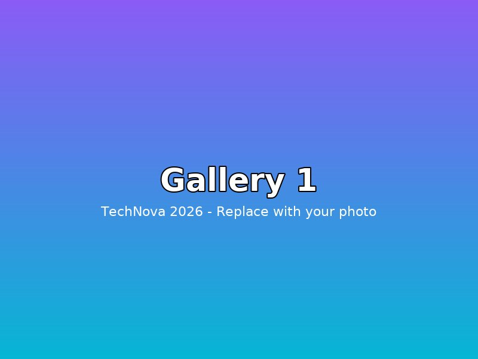

# TechNova 2026 — IEM Tech Fest Website

> **Glassmorphism • Futuristic Dark Neon • Pure HTML5 + CSS3 + Vanilla JS (no frameworks)**

Live Website (GitHub Pages): **https://poush-46.github.io/IEMTECHFEST/**  
Alternate URL (case-insensitive): https://poush-46.github.io/IEMTECHFEST

> ⚡ If the link shows 404, enable Pages once: GitHub repo → **Settings → Pages** → **Build and deployment → Deploy from a branch** → Branch: `main` → Folder: `/ (root)` → **Save**. Your site will be live at the `.io` link above in ~1 minute.

---

## Folder Structure

```
IEMTECHFEST/
├── index.html          # Single-page website (all sections, semantic HTML)
├── style.css           # All styles: glassmorphism, animations, responsive, variables
├── script.js           # All interactivity: countdown, clock, validation, modals, etc.
├── images/
│   ├── gallery1.jpg    # Replace with your photos (800×600, JPG)
│   ├── gallery2.jpg    # Tall image 800×1000 (auto-spans 2 rows)
│   ├── gallery3.jpg
│   ├── gallery4.jpg
│   ├── gallery5.jpg    # Tall
│   ├── gallery6.jpg
│   ├── gallery7.jpg
│   └── gallery8.jpg
└── README.md           # This file
```

Copy this structure when you upload to any host — keep `index.html` at the root.

---

## Quick Start — How to Run

### 1) Double-click (easiest)
Open `index.html` directly in Chrome / Edge / Firefox. Everything works offline except Google Fonts & Font Awesome (they need internet).

### 2) VS Code Live Server (recommended)
- Install **Live Server** extension in VS Code
- Right-click `index.html` → **Open with Live Server** → `http://127.0.0.1:5500`

### 3) Python local server
```bash
# in the IEMTECHFEST folder
python -m http.server 8000
# open http://localhost:8000
```

### 4) Node (npx)
```bash
npx serve .
```

No build step, no npm install, no frameworks.

---

## Where to Change Text, Images & Dates

### Fest Name, Tagline, College, Venue
Open `index.html` → top of file has a comment guide. Search for **TechNova 2026** (find & replace all):

| What | Where in `index.html` |
|------|------------------------|
| **Fest name** | `<title>`, hero `<h1>TechNova`, logo, footer |
| **Tagline** | `Innovate • Create • Elevate` under hero title |
| **College** | About section + footer + contact venue |
| **Dates** | Hero eyebrow `12–14 Dec 2026` + meta pills + event cards |
| **Venue** | Hero meta pill + About highlights + Contact info + map iframe |

### Theme Colors (one place)
Open `style.css` → very top `:root { ... }`

```css
:root {
  --primary: #8B5CF6;      /* Neon Purple — change me */
  --secondary: #06B6D4;    /* Cyan */
  --accent: #EC4899;       /* Pink */
  --bg-dark: #080B1E;      /* Page background */
  --glass-bg: rgba(255,255,255,0.07);
  --glass-border: rgba(255,255,255,0.12);
  --glass-blur: blur(16px);
}
```
Change those 3 colors and the whole site re-themes. Light mode overrides are under `[data-theme="light"]`.

### Fest Start Date (Countdown Timer)
Open `script.js` → line ~38:

```js
const FEST_START_DATE = new Date('2026-12-12T09:00:00+05:30'); // IST
```
Use `YYYY-MM-DDTHH:MM:SS+05:30` format. The hero countdown auto-calculates days/hours/mins/secs. If the date is past, it shows **“TechNova is LIVE!”**.

### Images / Gallery
1. Prepare 8 photos: `gallery1.jpg` … `gallery8.jpg`
   - Recommended: `800×600` JPG, < 400 KB each, sRGB
   - `gallery2.jpg` and `gallery5.jpg` are “tall” (800×1000) for masonry effect
2. Replace files in `/images/` keeping the **same names**.
3. In `index.html` → Gallery section → update `alt` text for accessibility:
```html

```
No code change needed — lightbox picks up whatever is in `src` automatically.

### Events (add / edit / remove)
In `index.html` → `section#events` → `.events-grid`:

```html
<article class="event-card tilt-card glass" data-category="coding" data-event="YourEventName">
  <div class="event-top">
    <span class="event-cat coding">Coding</span> <!-- coding/robotics/gaming/design/quiz/cultural -->
    <span class="event-prize"><i class="fas fa-trophy"></i> ₹30k</span>
  </div>
  <h3 class="event-title">Your Event Title</h3>
  <p class="event-desc">Short description...</p>
  <ul class="event-meta">
    <li><i class="far fa-calendar"></i> 13 Dec • 11:00 AM</li>
    <li><i class="fas fa-map-marker-alt"></i> Venue</li>
    <li><i class="fas fa-users"></i> Team size</li>
  </ul>
  <button class="btn btn-primary btn-block event-register">Register</button>
</article>
```
Filter buttons use `data-filter="coding"` etc. — must match `data-category` on cards.

### Schedule / Timeline
In `index.html` → `section#schedule` → `.timeline` blocks for `#timeline-day1`, `day2`, `day3`.

### Contact & Map
- Update phone/email in `section#contact` → `.contact-info`
- Map: replace `<iframe src="https://www.google.com/maps/embed?...">` with your venue’s embed URL (Google Maps → Share → Embed a map).

### Typography
Google Fonts loaded in `<head>`:
```html
Orbitron + Space Grotesk (headings) • Poppins + Inter (body)
Gradient text uses background-clip.
```

---

## Features Checklist

- Sticky glass navbar (logo, smooth-scroll, active-link via IntersectionObserver, hamburger, login/register, digital clock)
- Hero with 3D perspective title + rotating CSS cube + floating blur orbs + particle canvas + live countdown + parallax
- Digital clock (IST) updating every second (nav + hero glass widget)
- Glassmorphism throughout (`backdrop-filter: blur(16px)`, rgba, 1px border, layered shadow, inner glow)
- Animated gradient mesh background with blurred neon orbs + canvas star field
- Scroll-reveal (fade/slide/scale) via IntersectionObserver, reduced-motion aware
- 3D tilt on cards following mouse (vanilla JS) + magnetic buttons + ripple + glow hovers
- Animated counters (5000+, 40+, 100+, ₹5L) counting up on scroll
- Events grid + category filters (8 samples), 3D lift/glow
- Day 1/2/3 animated timeline tabs
- Masonry gallery + lightbox (next/prev, close, keyboard arrows, Esc, swipe, focus)
- Registration glass modal (name, email, 10-digit phone, college, dept, year, event, terms) — real-time validation, inline errors, green/red states, shake, success popup, localStorage
- Auth flip-card modal (Login / Sign-up) — show/hide password, strength meter, confirm match, remember me, localStorage demo, navbar user badge
- Sponsors auto-scrolling marquee (CSS, 2 rows, reverse)
- FAQ animated accordion (single-open, smooth grid expand)
- Contact glass form + socials hover + Google Map placeholder + validation
- Footer (links, socials, newsletter with validation)
- Extras: preloader, scroll progress bar, custom glowing cursor, dark/light toggle (localStorage), back-to-top, toast notifications, lazy-load, throttled scroll/mouse

---

## Code Quality

- **No external JS libraries** — only Font Awesome CSS via CDN (allowed)
- **Throttled** scroll & mouse handlers with `requestAnimationFrame`
- **IntersectionObserver** for reveals/counters/nav (no scroll-spam)
- **Semantic HTML5**: `<header>`, `<nav>`, `<main>`, `<section>`, `<footer>`, `<form>`, `<figure>`
- **Accessible**: alt text, `aria-label`, `aria-expanded`, `role`, keyboard lightbox, focus-visible outlines, good contrast
- **Responsive**: 1220px container, 1100/900/600 breakpoints, mobile hamburger + drawer
- **Comments**: each file has section headers explaining what & where to edit
- **Performance**: lazy-loaded images, CSS-only animations where possible, `will-change`, `prefers-reduced-motion` disables parallax/cursor/particles

---

## Hosting Free — GitHub Pages (recommended) & Netlify

### GitHub Pages (gives you the `.io` link)

**Your link is:** `https://poush-46.github.io/IEMTECHFEST/`

Steps (one-time, 60 seconds):
1. Push your code to GitHub (already on `main`):
   ```bash
   git add index.html style.css script.js images/ README.md
   git commit -m "feat: TechNova 2026 glassmorphism site"
   git push origin main
   ```
2. On GitHub → repo `poush-46/IEMTECHFEST` → **Settings** → **Pages** (left sidebar)
3. Under **Build and deployment**:
   - Source: **Deploy from a branch**
   - Branch: **main** → `/(root)` → **Save**
4. Wait ~30–60 seconds. Refresh the Pages section — you’ll see:  
   `Your site is live at https://poush-46.github.io/IEMTECHFEST/`
5. Future pushes to `main` auto-redeploy.

**Custom domain (optional):** Pages → Custom domain → enter `technova2026.com` → add `CNAME` DNS.

**Troubleshooting:**
- 404? Check filename is exactly `index.html` at repo root, not inside a folder.
- CSS/JS not loading? Use relative paths (`style.css`, not `/style.css`).
- Images broken? Keep `/images/` at root beside `index.html`.

### Netlify (drag & drop, also free)

1. Go to **https://app.netlify.com/drop**
2. Drag the entire `IEMTECHFEST` folder onto the drop zone
3. Site is live instantly at `https://<random>.netlify.app`
4. To use GitHub: Netlify → **Add new site → Import from GitHub** → pick `IEMTECHFEST` → Build: *none* → Publish dir: `/`

### Vercel (alternative)
- `vercel --prod` or import repo at vercel.com — same zero-build setup.

---

## Customization Recipes

**Change fonts:** Replace Google Fonts link in `<head>` and update `--font-heading` / `--font-body` in `style.css`.

**Add more particles:** In `script.js` → `COUNT` near `particle canvas`.

**Disable cursor for mobile:** Already handled via `hover: none` media query; no edit needed.

**Add new event category:** Add `<button data-filter="newcat">` + use `data-category="newcat"` on cards + add `.event-cat.newcat` gradient in CSS.

---

## Browser Support

Chrome/Edge/Firefox/Safari (last 2 versions). `backdrop-filter` has 95%+ support; Safari needs `-webkit-` prefix (already included). Particles & cursor disable gracefully if `prefers-reduced-motion`.

---

## Credits

- Design & Code: **IEM Tech Team** — vanilla HTML/CSS/JS
- Fonts: **Google Fonts** (Orbitron, Space Grotesk, Poppins, Inter)
- Icons: **Font Awesome 6.5.2** CDN
- Palette: Neon Purple `#8B5CF6` • Cyan `#06B6D4` • Pink `#EC4899` on `#080B1E`
- Images: Placeholder gradients generated locally; replace with your fest photos.

---

## License

Free to use for educational / college fest purposes. Keep the footer credit or replace with your own.

> Made with ❤️ by IEM Kolkata — TechNova 2026
